# OAuth2 e PKCE: guia de referência

Este guia explica, do zero, o que é OAuth2, o que é PKCE e como os dois se encaixam nesta POC. A primeira parte não exige conhecimento técnico. A segunda mostra a arquitetura em diagramas C4 e UML. A última é um checklist de segurança para quem vai implementar isso num sistema real.

> **Como ver os diagramas:** todos estão em [Mermaid](https://mermaid.js.org/). Eles renderizam direto no GitHub, no GitLab, no IntelliJ e no VS Code (com a extensão *Markdown Preview Mermaid Support*). Fora disso, cole o bloco em https://mermaid.live.

## Sumário

1. [O problema que o OAuth2 resolve](#1-o-problema-que-o-oauth2-resolve)
2. [Os quatro papéis](#2-os-quatro-papéis)
3. [Vocabulário essencial](#3-vocabulário-essencial)
4. [Qual fluxo usar](#4-qual-fluxo-usar)
5. [O que é PKCE e por que ele existe](#5-o-que-é-pkce-e-por-que-ele-existe)
6. [Arquitetura em C4](#6-arquitetura-em-c4)
7. [Diagramas de sequência](#7-diagramas-de-sequência)
8. [Diagramas de atividade](#8-diagramas-de-atividade)
9. [Anatomia do access token](#9-anatomia-do-access-token)
10. [Cuidados de segurança num sistema real](#10-cuidados-de-segurança-num-sistema-real)
11. [Referências](#11-referências)

---

## 1. O problema que o OAuth2 resolve

### A analogia do hotel

Pense num hotel:

- Na **recepção** você mostra o documento uma única vez. A recepção confere quem você é e te entrega um **cartão-chave**.
- O cartão abre **só as portas que você pode abrir** (seu quarto, a academia) e **para de funcionar** no dia do check-out.
- A **porta do quarto não sabe seu nome**. Ela só confere se o cartão é válido e se tem permissão para aquela porta.
- Se você perder o cartão, quem achar entra no seu quarto, mas só até o cartão expirar. Por isso ele vale por pouco tempo.

O OAuth2 é exatamente isso para sistemas:

| Hotel | OAuth2 |
|-------|--------|
| Recepção | **Authorization Server** (servidor de autorização) |
| Você | **Resource Owner** (o usuário) |
| Cartão-chave | **Access token** |
| Portas que o cartão abre | **Scopes** (escopos) |
| A porta do quarto | **Resource Server** (a API) |
| O app que você usa para pedir o cartão | **Client** (o front-end, o app mobile, o BFF) |

### O que isso resolve na prática

Sem OAuth2, cada aplicação recebe a senha do usuário, guarda essa senha e manda um "ID do usuário" para a API em cada chamada. Os problemas são:

- A senha se espalha por vários sistemas.
- Qualquer um que troque o ID na chamada (`/users/123` → `/users/124`) pode ver dados de outra pessoa. Esse ataque tem nome: **IDOR**, ou *Insecure Direct Object Reference*.
- Não dá para dar acesso parcial ("só leitura do perfil") nem revogar o acesso de um app específico.

Com OAuth2:

- **A senha só é digitada no Authorization Server.** A aplicação nunca vê a senha.
- **A API descobre quem é o usuário pelo token**, que é assinado e não pode ser forjado. É por isso que esta POC chama `GET /me` sem mandar ID nenhum.
- O acesso é **limitado** (escopos), **temporário** (expiração) e **revogável**.

### OAuth2 não é login

Um detalhe que confunde muita gente: o OAuth2 é um protocolo de **autorização** ("o que este app pode acessar"). Para **autenticação** ("quem é o usuário"), existe o **OpenID Connect (OIDC)**, uma camada em cima do OAuth2 que adiciona o `id_token` e o endpoint `/userinfo`. Na prática quase sempre se usam os dois juntos.

| | OAuth2 | OpenID Connect |
|---|---|---|
| Pergunta que responde | "O que este app pode fazer?" | "Quem é este usuário?" |
| Token principal | `access_token` (para a API) | `id_token` (para o cliente) |
| Quem lê o token | A API (Resource Server) | O próprio cliente |

---

## 2. Os quatro papéis

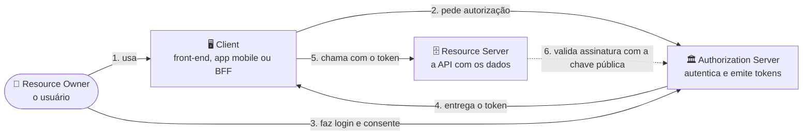

Nesta POC:

| Papel | Onde está | Porta |
|-------|-----------|-------|
| Resource Owner | Você, no navegador (alice ou bob) | — |
| Client (público) | `frontend/app.js` no modo SPA | 3000 |
| Client (confidencial) | `backend/bff.py` no modo BFF | 3000 |
| Authorization Server | `backend/auth_server.py` | 9000 |
| Resource Server | `backend/api.py` | 8000 |

**Cliente público ou confidencial?** Um cliente **confidencial** roda num servidor e consegue guardar um segredo (`client_secret`). Um cliente **público** roda no dispositivo do usuário (browser, celular), onde qualquer segredo embutido pode ser extraído. Por isso cliente público não tem segredo, e é aí que o PKCE se torna indispensável.

---

## 3. Vocabulário essencial

| Termo | Em uma frase |
|-------|--------------|
| **Authorization code** | Um código temporário e de uso único que o Authorization Server devolve depois do login. Sozinho não acessa nada: precisa ser trocado por um token. |
| **Access token** | A "chave" que o cliente manda para a API em `Authorization: Bearer <token>`. Vida curta (minutos). |
| **Refresh token** | Serve para pegar um novo access token sem pedir login de novo. Vida longa, então precisa de muito mais cuidado. |
| **Scope** | O que o token pode fazer. Ex.: `profile:read`. |
| **`redirect_uri`** | Para onde o Authorization Server devolve o usuário com o code. Precisa estar pré-cadastrada. |
| **`state`** | Valor aleatório que o cliente manda e confere na volta. Protege contra CSRF no callback. |
| **`code_verifier`** | Segredo aleatório gerado pelo cliente a cada login (PKCE). |
| **`code_challenge`** | O hash SHA-256 do `code_verifier`. É o que vai para o Authorization Server. |
| **JWT** | Formato de token com três partes (`header.payload.assinatura`) em Base64URL. É **assinado**, não **criptografado**. |
| **JWKS** | Endpoint onde o Authorization Server publica as chaves públicas para a API validar a assinatura dos JWTs. |
| **`sub`** | *Subject*: o identificador do usuário dentro do token. Deve ser opaco (um UUID), não o e-mail. |
| **`aud`** | *Audience*: para qual API o token foi emitido. Uma API deve recusar token emitido para outra. |
| **`iss`** | *Issuer*: quem emitiu o token. |
| **BFF** | *Backend for Frontend*: um backend que faz o OAuth2 pelo front e guarda os tokens no servidor. |

---

## 4. Qual fluxo usar

O OAuth2 tem vários *grant types* (formas de obter o token). Hoje, para qualquer cenário com usuário, a resposta é quase sempre **Authorization Code + PKCE**.

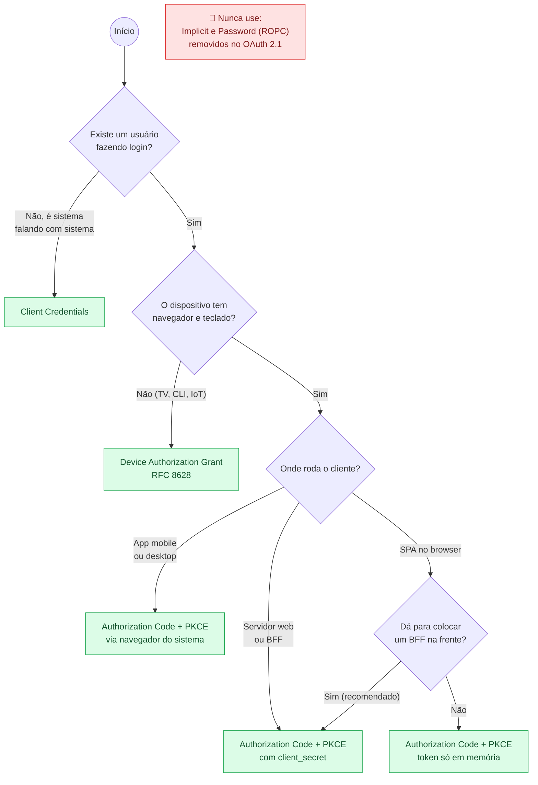

**Por que não o Implicit?** Ele devolvia o access token direto na URL (`#access_token=...`), onde vaza para histórico, logs e extensões do navegador. **Por que não o Password (ROPC)?** Porque o app recebe a senha do usuário, o que é justamente o que o OAuth2 quer evitar. Ele também não funciona com MFA nem com login social.

---

## 5. O que é PKCE e por que ele existe

PKCE (*Proof Key for Code Exchange*, pronuncia-se "pixy") é definido na [RFC 7636](https://www.rfc-editor.org/rfc/rfc7636). Ele resolve um problema específico: **o que acontece se alguém roubar o authorization code?**

### A analogia do manobrista

1. Antes de entregar o carro, você escreve uma **frase secreta** num papel e guarda no bolso. Esse papel é o **`code_verifier`**.
2. Você entrega ao manobrista só a **impressão digital** dessa frase, ou seja, um hash do qual não dá para descobrir a frase. Essa impressão digital é o **`code_challenge`**.
3. O manobrista te dá um **ticket**. Esse ticket é o **authorization code**.
4. Na volta, para pegar o carro, você mostra o ticket **e** o papel com a frase. O manobrista calcula a impressão digital da frase e compara com a que ele anotou.
5. Se alguém roubou **só o ticket**, não leva o carro, porque não tem o papel.

### Onde o code pode ser roubado

O code viaja numa URL de redirecionamento, e URLs vazam: por apps maliciosos registrando o mesmo *custom scheme* no celular, por extensões do navegador, por logs de proxy, pelo histórico ou pelo header `Referer`. Sem PKCE, quem tiver o code consegue trocar por um token. Com PKCE, o code é inútil sem o `code_verifier`, que **nunca sai do cliente** até o momento da troca, e nessa hora vai por uma requisição direta via HTTPS, não por redirect.

### O cálculo

```text
code_verifier  = 43 a 128 caracteres aleatórios (gerador criptográfico)
code_challenge = BASE64URL( SHA256( code_verifier ) )
```

Na POC:

- No browser: `randomString()` e `s256()` em [`frontend/app.js`](../frontend/app.js), usando `crypto.getRandomValues` e `crypto.subtle.digest`.
- No servidor: `pkce_challenge()` em [`backend/common.py`](../backend/common.py), usada pelo BFF para gerar o challenge e pelo Authorization Server para conferir.

> **Sempre use `S256`.** O método `plain` (challenge igual ao verifier) existe só por compatibilidade e não protege contra quem consegue ver a requisição de autorização.

O PKCE, que nasceu para apps mobile, hoje é **obrigatório para todos os clientes** no OAuth 2.1, inclusive os confidenciais, porque também impede ataques de injeção de code.

---

## 6. Arquitetura em C4

O [modelo C4](https://c4model.com/) descreve um sistema em níveis de zoom, como um mapa: país → cidade → bairro → rua.

| Nível | Pergunta | Para quem |
|-------|----------|-----------|
| 1. Contexto | Quem usa o sistema e com o que ele conversa? | Todo mundo, inclusive negócio |
| 2. Containers | Quais aplicações e bancos existem? | Arquitetos, devs, ops |
| 3. Componentes | O que tem dentro de cada aplicação? | Devs |
| 4. Código | Quais módulos, classes e funções? | Devs que vão mexer no código |

### 6.1 Nível 1: Contexto

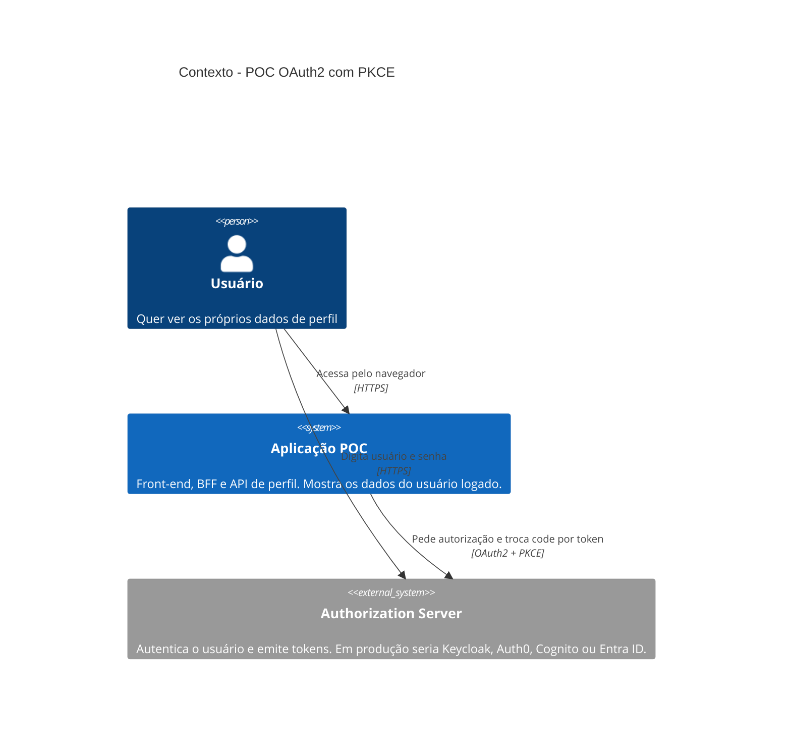

**Leitura:** o usuário usa a aplicação, mas a senha ele digita **só no Authorization Server**. A aplicação nunca vê a senha: ela recebe um token.

### 6.2 Nível 2: Containers

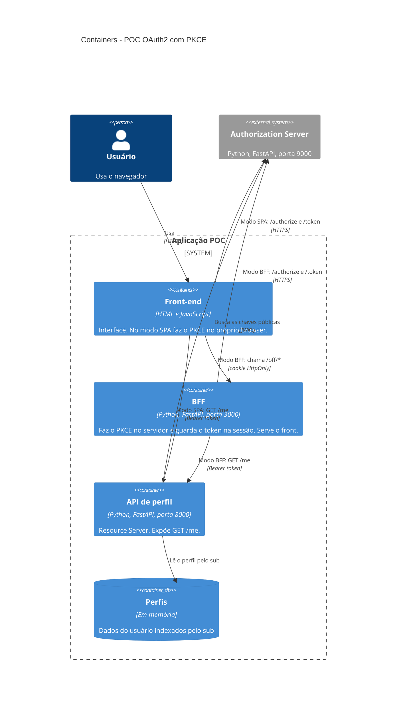

**Leitura:** a diferença entre os dois modos é **onde o token fica**. No modo SPA ele fica no browser e vai para a API direto. No modo BFF ele fica no servidor, e o browser só tem um cookie que o JavaScript não consegue ler.

### 6.3 Nível 3: Componentes

#### Authorization Server

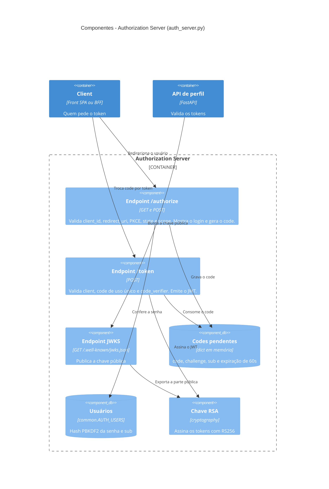

#### BFF

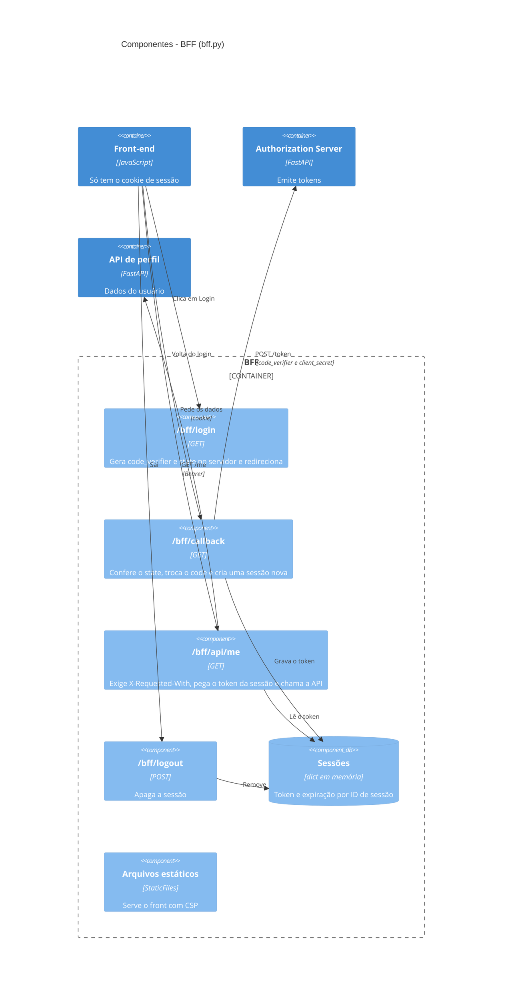

#### API de perfil (Resource Server)

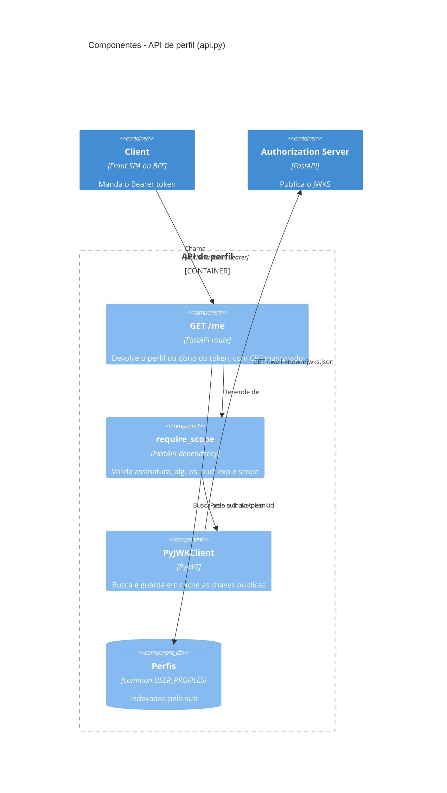

### 6.4 Nível 4: Código

No C4, o nível de código costuma ser um diagrama de classes UML. Como o Python da POC usa módulos com funções, cada módulo aparece como uma "classe" com o estereótipo `module`.

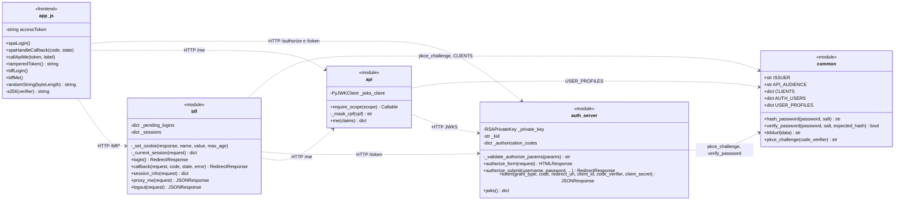

---

## 7. Diagramas de sequência

Diagramas de sequência mostram **quem fala com quem, em que ordem**. Leia de cima para baixo.

### 7.1 Visão geral, sem jargão

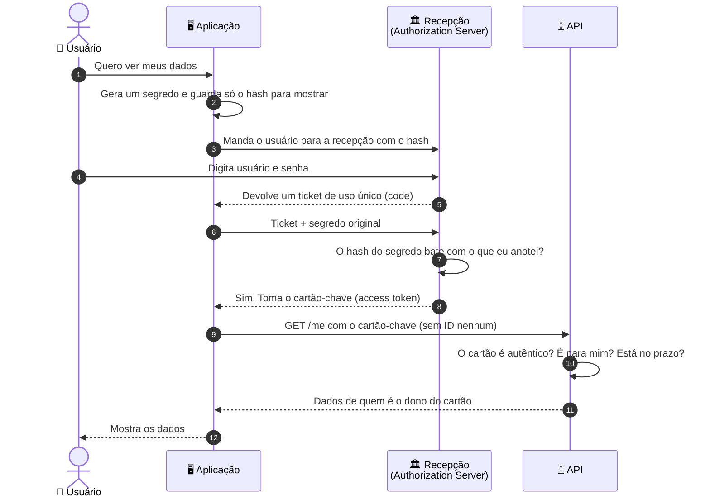

### 7.2 Modo SPA: PKCE no browser

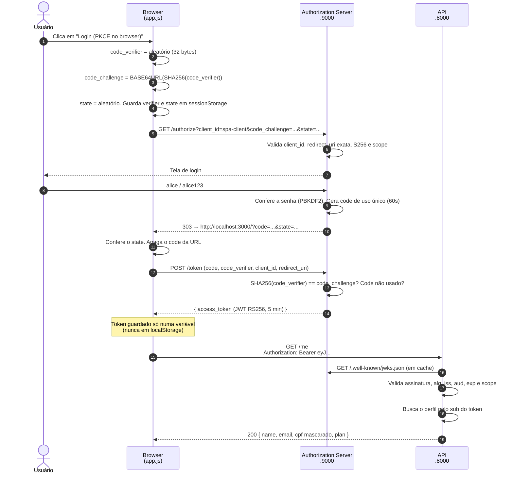

### 7.3 Modo BFF: o token nunca chega ao browser

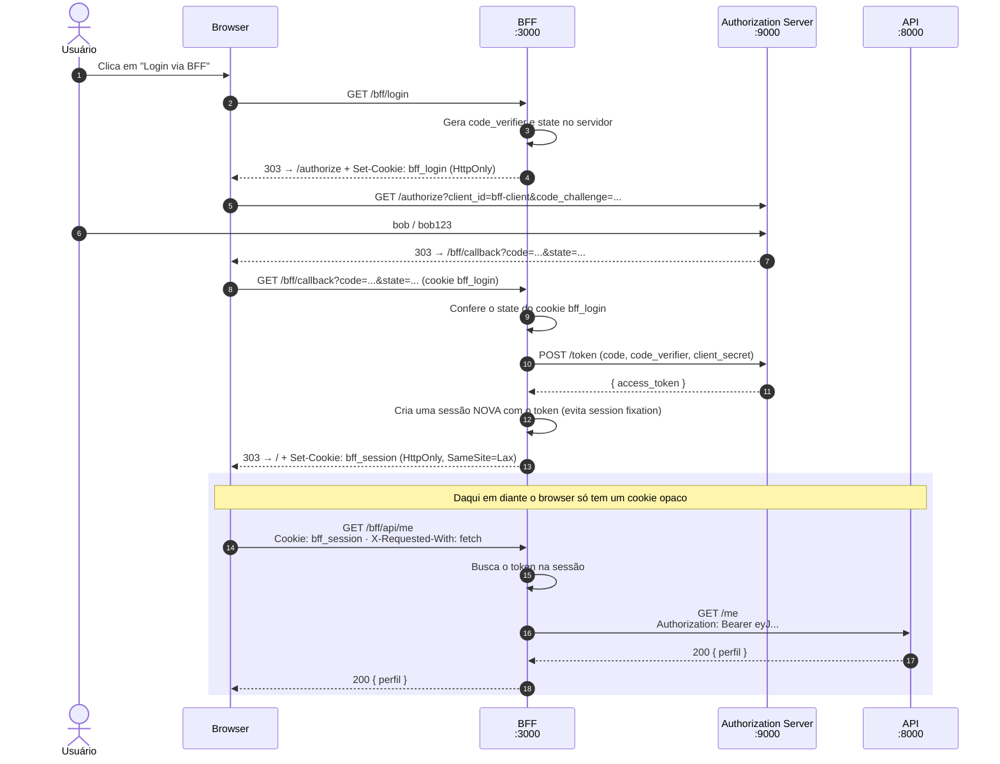

### 7.4 O ataque que o PKCE impede

Um atacante consegue ler a URL de retorno (por um app malicioso no celular, uma extensão ou um log) e rouba o code.

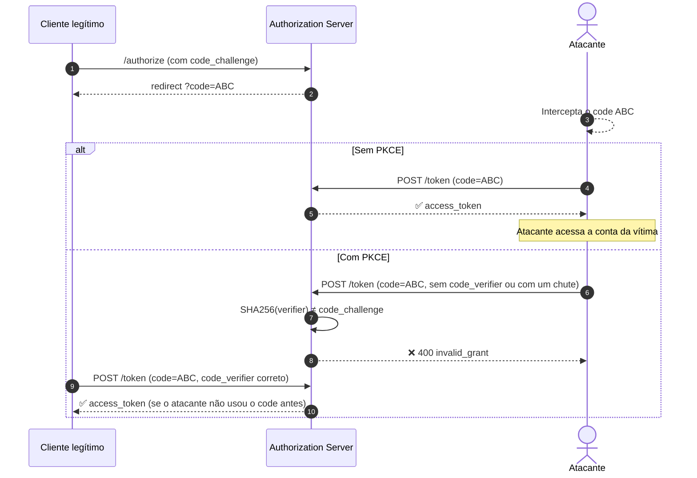

Na POC o code é de uso único e é consumido **mesmo quando a validação falha** (`_authorization_codes.pop(...)` em `token()`). Um atacante que tenta com um verifier errado queima o code, e o cliente legítimo precisa refazer o login, mas o atacante sai sem token.

### 7.5 Tentativa de se passar por outro usuário

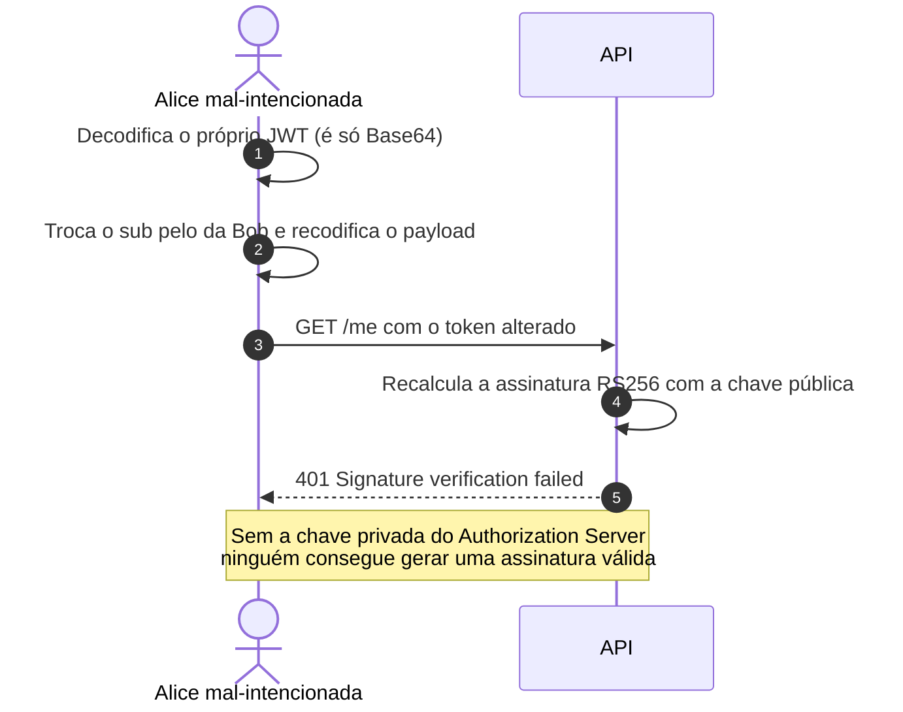

É o botão **"GET /me com sub adulterado"** no front da POC.

---

## 8. Diagramas de atividade

Diagramas de atividade mostram **decisões e caminhos possíveis**, como um fluxograma. Losangos são perguntas, e cada saída é uma resposta.

### 8.1 O que o Authorization Server confere em `POST /token`

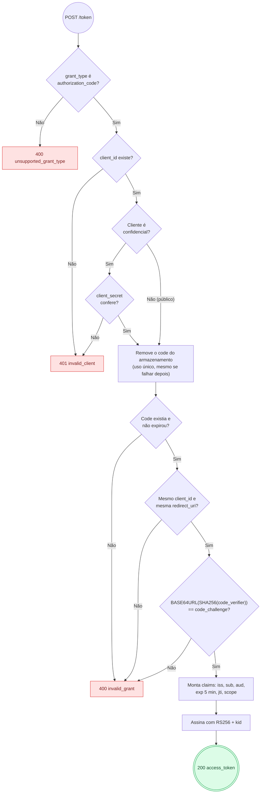

### 8.2 O que a API confere em `GET /me`

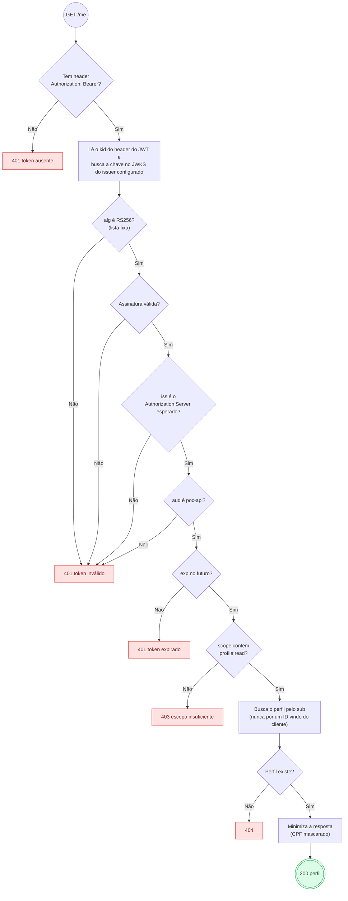

> **401 ou 403?** `401 Unauthorized` significa "não sei quem você é" (token ausente, inválido ou expirado): o cliente deve obter um novo token. `403 Forbidden` significa "sei quem você é, mas você não pode fazer isso": pedir outro token igual não resolve.

### 8.3 O que o BFF faz em cada chamada do front

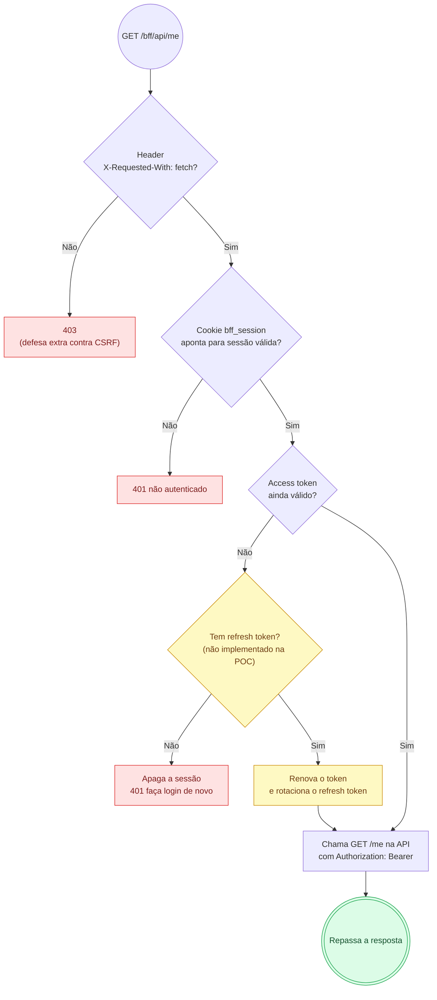

---

## 9. Anatomia do access token

Um JWT tem três partes separadas por ponto. As duas primeiras são **só Base64URL**: qualquer pessoa decodifica em segundos (teste em https://jwt.io). Só a terceira, a assinatura, garante que ninguém alterou nada.

```text
eyJhbGciOiJSUzI1NiIsImtpZCI6Ii4uLiJ9 . eyJpc3MiOiJodHRwOi8v... . kL9x2Qf...
└──────────── header ────────────┘   └───── payload ──────┘   └ assinatura ┘
```

**Header**

```json
{ "alg": "RS256", "typ": "JWT", "kid": "3f9a1c0e7b2d4a56" }
```

**Payload emitido pela POC**

```json
{
  "iss": "http://localhost:9000",
  "sub": "6f1c2a9e-3b7d-4e8a-9c51-2d4f8b0e7a13",
  "aud": "poc-api",
  "iat": 1792798301,
  "nbf": 1792798301,
  "exp": 1792798601,
  "jti": "bcd2fd152a814f7fb2a655df97027cfb",
  "scope": "profile:read",
  "client_id": "spa-client"
}
```

| Claim | Para que serve | Cuidado |
|-------|----------------|---------|
| `iss` | Quem emitiu | A API deve aceitar só o issuer configurado |
| `sub` | Quem é o usuário | UUID opaco. **Nunca** e-mail, CPF ou ID sequencial |
| `aud` | Para qual API é | Recuse tokens com outro `aud` |
| `exp`, `nbf`, `iat` | Janela de validade | Tolerância de relógio pequena (até ~60s) |
| `jti` | ID único do token | Útil para revogação e detecção de replay |
| `scope` | O que pode fazer | Confira em cada endpoint |

**O que nunca colocar no payload:** CPF, e-mail, telefone, endereço, dados de saúde, senhas ou qualquer dado sensível. Se a API precisa desses dados, ela busca no próprio banco usando o `sub`, que é o que a POC faz.

---

## 10. Cuidados de segurança num sistema real

A POC simplifica várias coisas para caber em poucos arquivos. Esta seção lista o que muda num sistema de verdade. Use como checklist de revisão.

### 10.1 Authorization Server

- [ ] **Não escreva o seu.** Use um produto maduro e auditado (Keycloak, Auth0, Okta, Cognito, Entra ID, Ory, Zitadel). O `auth_server.py` da POC existe só para estudo.
- [ ] **`redirect_uri` com comparação exata.** Nada de wildcard, prefixo ou regex. Uma `redirect_uri` frouxa permite mandar o code para o atacante.
- [ ] **PKCE obrigatório com `S256`** para todos os clientes, inclusive os confidenciais. Rejeite `plain`.
- [ ] **Authorization code curto e de uso único.** Expiração de no máximo alguns minutos. Se um code for reapresentado, revogue os tokens que já foram emitidos com ele.
- [ ] **Desabilite os grants Implicit e Password (ROPC).**
- [ ] **Proteja o login:** rate limit, bloqueio progressivo, MFA, detecção de credenciais vazadas, hash de senha forte (Argon2id, bcrypt ou PBKDF2 com muitas iterações).
- [ ] **Rotacione as chaves de assinatura** com `kid`, publicando a chave nova no JWKS antes de começar a usá-la e mantendo a antiga até os tokens antigos expirarem.
- [ ] **Mostre a tela de consentimento** com os escopos pedidos, quando o cliente for de terceiros.
- [ ] **Envie o `iss` na resposta de autorização** (RFC 9207) se o cliente fala com mais de um Authorization Server, para evitar ataques de *mix-up*.

### 10.2 Cliente (front-end, mobile, BFF)

- [ ] **Prefira BFF para SPAs.** Token no servidor e cookie `HttpOnly` no browser é a opção mais segura para aplicações web. É a recomendação do draft *OAuth 2.0 for Browser-Based Applications* da IETF.
- [ ] **SPA sem BFF:** guarde o access token **só em memória**, nunca em `localStorage` ou `sessionStorage` (qualquer XSS lê esses dois). Use CSP rígida e tokens bem curtos.
- [ ] **Mobile e desktop:** faça o login pelo **navegador do sistema** (`ASWebAuthenticationSession` no iOS, *Custom Tabs* no Android), nunca por WebView embutida (RFC 8252). Prefira *App Links* / *Universal Links* (`https://`) a *custom schemes* como `meuapp://`, que outro app pode registrar.
- [ ] **`code_verifier` com entropia alta** (32 bytes ou mais de um gerador criptográfico), novo a cada login.
- [ ] **`state` aleatório e conferido** no callback. No OIDC, use também o `nonce` e confira no `id_token`.
- [ ] **Remova o `code` da URL** depois do callback (`history.replaceState`) e use `Referrer-Policy: no-referrer` ou `strict-origin`.
- [ ] **Peça o mínimo de escopos.**
- [ ] **Não mande o `id_token` para a API.** O `id_token` é para o cliente. Para a API, use o access token.
- [ ] **Nunca embuta `client_secret` em front-end ou app mobile.** Se está no código que vai para o dispositivo do usuário, não é segredo.
- [ ] **Logout de verdade:** revogue os tokens no Authorization Server (RFC 7009), apague a sessão local e, no OIDC, chame o *end session endpoint*.

### 10.3 Tokens

- [ ] **Access token de vida curta**: 5 a 15 minutos.
- [ ] **Refresh token com rotação e detecção de reuso.** Cada uso gera um refresh token novo. Se um refresh token antigo aparecer de novo, alguém o copiou: revogue a família inteira.
- [ ] **Nada sensível no JWT.** Lembre que o payload é legível. Use `sub` opaco, de preferência *pairwise* (um `sub` diferente por cliente, para que dois sistemas não consigam cruzar dados do mesmo usuário).
- [ ] **Considere tokens opacos** com *introspection* (RFC 7662) quando o token sai da sua rede, ou o padrão *phantom token* (o gateway troca o token opaco por um JWT internamente).
- [ ] **Restrinja o `aud`** a uma API (ou a um conjunto pequeno), usando *Resource Indicators* (RFC 8707) se o Authorization Server suportar.
- [ ] **Tokens amarrados ao cliente** (*sender-constrained*): **DPoP** (RFC 9449) ou **mTLS** (RFC 8705). Assim um token roubado não funciona em outra máquina.

### 10.4 API (Resource Server)

- [ ] **Valide tudo, sempre:** assinatura, `iss`, `aud`, `exp`, `nbf`. Use uma biblioteca consolidada (PyJWT, `jose`, Spring Security, Nimbus), nunca um parser feito à mão.
- [ ] **Fixe a lista de algoritmos aceitos** (ex.: só `RS256` ou `ES256`). Isso bloqueia o `alg: none` e o ataque de confusão RS256 → HS256, em que o atacante assina com a chave pública como se fosse um segredo HMAC.
- [ ] **Busque a chave só no JWKS do issuer configurado.** Ignore os headers `jku`, `x5u` e `jwk` do token, porque eles deixam o atacante apontar para a chave dele.
- [ ] **Derive a identidade do token, nunca do request.** Use endpoints como `/me`. Quando o recurso tem ID na URL (`/pedidos/{id}`), **confira se o dono do pedido é o `sub` do token**. Escopo não é permissão sobre o objeto: esse é o risco número 1 do OWASP API Top 10 (*Broken Object Level Authorization*).
- [ ] **Confira o escopo em cada endpoint** e responda `401` ou `403` corretamente, com `WWW-Authenticate`.
- [ ] **Devolva o mínimo de dados.** Mascare o que não for necessário.
- [ ] **CORS restrito:** liste as origens permitidas. Nunca use `*` junto com credenciais.
- [ ] **Não confie em tokens só porque estão no formato certo.** Um token de outro issuer válido (ex.: emitido pelo mesmo provedor para outro tenant) também precisa ser recusado.

### 10.5 Sessão e cookies (BFF)

- [ ] **Cookie de sessão:** `HttpOnly`, `Secure`, `SameSite=Lax` ou `Strict`, `Path=/` e prefixo `__Host-` (ex.: `__Host-session`), que obriga `Secure` e impede outros subdomínios de sobrescrever o cookie.
- [ ] **ID de sessão novo depois do login**, para evitar *session fixation*.
- [ ] **Expiração absoluta e por inatividade** da sessão, controladas no servidor.
- [ ] **Proteção contra CSRF** em tudo que muda estado: `SameSite` mais um header customizado ou token anti-CSRF.
- [ ] **Armazene sessões fora da memória do processo** (Redis, banco), com os tokens cifrados em repouso.
- [ ] **Nunca devolva o access token para o browser** em nenhum endpoint do BFF.

### 10.6 Transporte, infraestrutura e operação

- [ ] **HTTPS em tudo**, com HSTS. Sem exceção para "rede interna".
- [ ] **Segredos em cofre** (Vault, AWS Secrets Manager, Azure Key Vault), nunca no código ou no repositório. Na POC o `client_secret` tem um valor padrão só para rodar local.
- [ ] **Não logue** tokens, codes, `code_verifier`, `client_secret` nem o header `Authorization`. Mascare antes de logar.
- [ ] **Rate limit** em `/authorize`, `/token` e nos endpoints de login.
- [ ] **Monitore e alerte:** reuso de refresh token, pico de falhas de assinatura, muitos `invalid_grant` vindos do mesmo IP.
- [ ] **Mantenha as bibliotecas de OAuth/JWT atualizadas.** Essas bibliotecas são alvo frequente de CVEs.
- [ ] **Use os headers de segurança** no front: CSP sem `unsafe-inline`, `X-Content-Type-Options: nosniff`, `frame-ancestors 'none'`.

### 10.7 Erros comuns

| Erro | O que acontece | Como evitar |
|------|----------------|-------------|
| Mandar o ID do usuário na URL (`/users/123`) e confiar nele | Qualquer um vê dados de outra pessoa trocando o número (IDOR/BOLA) | Usar `/me` ou conferir o dono contra o `sub` |
| Guardar token em `localStorage` | Um XSS rouba o token | BFF, ou token só em memória |
| Colocar CPF ou e-mail no JWT | Vazamento de dados pessoais em logs e no browser | `sub` opaco, dados buscados no banco |
| Aceitar qualquer `alg` | Atacante forja token com `alg: none` | Lista fixa de algoritmos |
| Não validar `aud` | Token de outra API é aceito na sua | Validar `aud` sempre |
| `redirect_uri` com wildcard | Code enviado para domínio do atacante | Comparação exata |
| Usar o grant Implicit | Token vaza na URL | Authorization Code + PKCE |
| Refresh token sem rotação | Um refresh token roubado vale por semanas | Rotação + detecção de reuso |
| Usar `id_token` como access token na API | API aceita token que não foi feito para ela | `access_token` com `aud` da API |
| Embutir `client_secret` no app mobile | Segredo extraído do binário | Cliente público + PKCE |
| Logar o header `Authorization` | Tokens válidos nos logs | Mascarar antes de logar |

### 10.8 O que a POC já faz e o que falta

| Cuidado | POC |
|---------|-----|
| PKCE S256 obrigatório | ✅ |
| `redirect_uri` exata | ✅ |
| Code de uso único com expiração | ✅ |
| `state` obrigatório e conferido | ✅ |
| `sub` opaco, sem dados pessoais no token | ✅ |
| Validação de assinatura, `alg`, `iss`, `aud`, `exp` e escopo | ✅ |
| `/me` sem ID do cliente | ✅ |
| Token em memória (SPA) e cookie HttpOnly (BFF) | ✅ |
| Rotação do ID de sessão, CSP, `Referrer-Policy` | ✅ |
| HTTPS e cookie `Secure` | ⚠️ desligado em localhost (`COOKIE_SECURE`) |
| Authorization Server de mercado | ❌ implementação de estudo |
| Refresh token com rotação | ❌ |
| Sessões e codes em armazenamento externo | ❌ em memória |
| DPoP ou mTLS | ❌ |
| Rate limit e MFA no login | ❌ |
| Revogação de tokens no logout | ❌ |
| Segredos em cofre | ❌ valor padrão no código |

---

## 11. Referências

**Especificações**

- [RFC 6749](https://www.rfc-editor.org/rfc/rfc6749): The OAuth 2.0 Authorization Framework
- [RFC 6750](https://www.rfc-editor.org/rfc/rfc6750): Bearer Token Usage
- [RFC 7636](https://www.rfc-editor.org/rfc/rfc7636): Proof Key for Code Exchange (PKCE)
- [RFC 7519](https://www.rfc-editor.org/rfc/rfc7519): JSON Web Token (JWT)
- [RFC 7517](https://www.rfc-editor.org/rfc/rfc7517): JSON Web Key (JWK)
- [RFC 7009](https://www.rfc-editor.org/rfc/rfc7009): Token Revocation
- [RFC 7662](https://www.rfc-editor.org/rfc/rfc7662): Token Introspection
- [RFC 8252](https://www.rfc-editor.org/rfc/rfc8252): OAuth 2.0 for Native Apps
- [RFC 8707](https://www.rfc-editor.org/rfc/rfc8707): Resource Indicators
- [RFC 8705](https://www.rfc-editor.org/rfc/rfc8705): Mutual-TLS Client Authentication and Certificate-Bound Tokens
- [RFC 9068](https://www.rfc-editor.org/rfc/rfc9068): JWT Profile for OAuth 2.0 Access Tokens
- [RFC 9207](https://www.rfc-editor.org/rfc/rfc9207): Authorization Server Issuer Identification
- [RFC 9449](https://www.rfc-editor.org/rfc/rfc9449): DPoP
- [RFC 9700](https://www.rfc-editor.org/rfc/rfc9700): Best Current Practice for OAuth 2.0 Security
- [OAuth 2.1 (draft)](https://datatracker.ietf.org/doc/draft-ietf-oauth-v2-1/)
- [OAuth 2.0 for Browser-Based Applications (draft)](https://datatracker.ietf.org/doc/draft-ietf-oauth-browser-based-apps/)
- [OpenID Connect Core 1.0](https://openid.net/specs/openid-connect-core-1_0.html)

**Leitura complementar**

- [OWASP API Security Top 10](https://owasp.org/API-Security/)
- [OWASP Cheat Sheet: OAuth 2.0](https://cheatsheetseries.owasp.org/cheatsheets/OAuth2_Cheat_Sheet.html)
- [OWASP Cheat Sheet: JSON Web Token](https://cheatsheetseries.owasp.org/cheatsheets/JSON_Web_Token_for_Java_Cheat_Sheet.html) (os exemplos são em Java, mas os cuidados valem para qualquer linguagem)
- [Modelo C4](https://c4model.com/)
- [oauth.net](https://oauth.net/2/)
